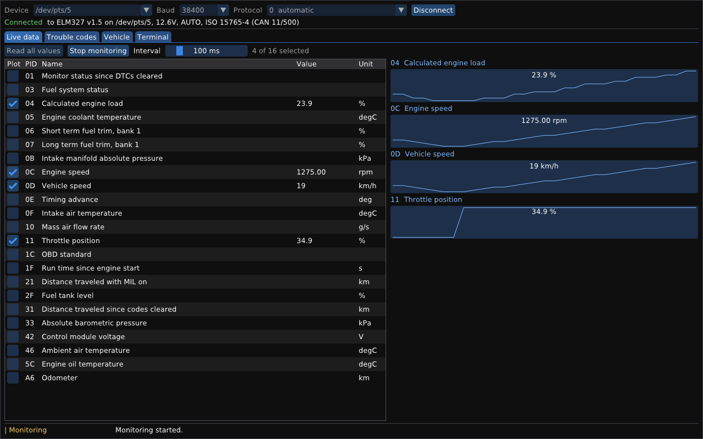

# Elm327Controller

Tools and a library for ELM327 OBD-II adapters on Linux. They read live values, trouble codes and
the VIN from a vehicle, monitor values over time, and pass raw commands to the adapter.

The project has two parts:

- **`libelm327`**, a static library with everything needed to control an adapter: the serial
  protocol of the ELM327, the OBD-II services, and `Controller`, the connection the front-ends
  share.
- **The front-ends** built on it:
  - **`elm327ctl`**, a command-line tool. Started without a command it is an interactive shell that
    keeps the connection open between commands, with line editing, history and completion. Given a
    command, it runs that command once, for scripts.
  - **`elm327gui`**, a graphical front-end drawn with [Dear ImGui](https://github.com/ocornut/imgui):
    live data with plots, trouble codes, the VIN, and a terminal for AT commands.

`elm327sim` simulates an adapter and a vehicle on a pseudo-terminal, to try everything without
hardware.

It is built on [Common](https://github.com/Emre-Balci/Common), the real-time foundation library.
Common and Dear ImGui are git submodules in `third_party/`. The library and the command-line tool
follow Common's rules: no heap, no exceptions, and every wait is bounded by a deadline.

Status: version 0.2.0. See [Next steps](#next-steps).



## Quick start

```bash
git clone --recurse-submodules https://github.com/Emre-Balci/Elm327Controller.git
cd Elm327Controller
sudo apt install libglfw3-dev     # for elm327gui; without it only the GUI is left out
cmake --preset gcc-release && cmake --build --preset gcc-release
```

If the repository was cloned without `--recurse-submodules`, run `git submodule update --init`.

No adapter at hand? `elm327sim` simulates one on a pseudo-terminal, connected to a car that keeps
accelerating and braking:

```bash
./build/gcc-release/sim/elm327sim &                  # prints e.g. "Simulated ELM327 on /dev/pts/5"
./build/gcc-release/cli/elm327ctl -d /dev/pts/5      # the interactive shell
./build/gcc-release/cli/elm327ctl -d /dev/pts/5 info # one command
./build/gcc-release/gui/elm327gui -d /dev/pts/5 --monitor 0C,0D
```

`elm327sim --legacy` simulates an ISO 9141-2 car instead of a CAN car, `--ignition-off` a car that
does not answer, and `--slow` the reset and protocol-search times of a real adapter.

## The interactive shell

Without a command, `elm327ctl` reads commands line by line. The options of the command line become
its settings. The first command that needs the adapter connects to it, and the connection stays
open, so the adapter is reset once and the supported PIDs are read once:

```
$ elm327ctl -d /dev/pts/5
elm327ctl 0.2.0, the shell for ELM327 adapters. Type 'help' for the commands, 'quit' to leave.
elm327> info
Connected to ELM327 v1.5 on /dev/pts/5 at 38400 bit/s.
Adapter      ELM327 v1.5
Description  OBDII to RS232 Interpreter
Voltage      12.6V
Protocol     AUTO, ISO 15765-4 (CAN 11/500)
elm327> read 0C 0D
0C  Engine speed   900.00 rpm
0D  Vehicle speed  4 km/h
elm327> monitor -i 250 0C
# 0C  Engine speed [rpm]
  time [s]        0C
     0.000   2375.00
     0.250   2400.00
^Celm327ctl: 2 samples, 0 failed reads
elm327> set protocol 6
Disconnected: the next command connects with the new setting.
elm327> quit
```

| Command | What it does |
|---|---|
| `connect [DEVICE]` | connect to the adapter, at `DEVICE` if given (it becomes the device setting) |
| `disconnect` | close the connection |
| `info`, `pids`, `read PID...`, `monitor PID...`, `dtc`, `vin`, `raw COMMAND...` | as on the [command line](#commands-for-scripts) |
| `set NAME VALUE` | change a setting: `device`, `baud`, `protocol`, `timeout`, `interval`, `count`, `verbose` (`on`/`off`) |
| `show` (or `set` alone) | show the settings and the connection |
| `help` | list the commands, settings and keys |
| `quit`, `exit` | leave the shell (also Ctrl+D) |

The options of the command line work on a line for that command only, e.g. `monitor -i 250 -n 10
0C 0D` or `read -v 0C`. The connection settings are changed with `set` instead, and a change of
`device`, `baud`, `protocol` or `timeout` closes the connection, so that the next command connects
with it.

Keys: Ctrl+C stops the running command and returns to the prompt; at the prompt it discards the
line. Tab completes commands, settings and their values. Up and Down browse the history. The usual
editing keys of GNU Readline work: Home, End, Ctrl+A, Ctrl+E, Ctrl+U, Ctrl+K, Ctrl+W, Alt+B,
Alt+F, Ctrl+L.

Without a terminal, e.g. with `elm327ctl -d /dev/ttyUSB0 < script.txt`, the shell reads plain lines
without prompt or editing; `#` starts a comment. Its exit code is that of the last command.

## Commands for scripts

```
Usage: elm327ctl [options] [command [arguments]]

Commands:
  info              adapter identity, supply voltage and the vehicle's protocol
  pids              list the service 01 PIDs the vehicle supports
  read PID...       read service 01 PIDs once, e.g. 'read 0C 0D 05'
  monitor PID...    read PIDs repeatedly until Ctrl+C (see -i, -n)
  dtc               read the MIL status and the stored, pending and permanent DTCs
  vin               read the vehicle identification number
  raw COMMAND...    send AT commands or OBD requests and print the replies
  help              show this help

Options:
  -d, --device PATH   serial device (default /dev/ttyUSB0)
  -b, --baud RATE     bit rate (default 38400)
  -p, --protocol N    OBD protocol 0-9 or A-C (default 0: automatic)
  -t, --timeout MS    reply timeout of a command in ms (default 5000)
  -i, --interval MS   monitor: time between samples in ms (default 1000)
  -n, --count N       monitor: stop after N samples (default 0: until Ctrl+C)
  -v, --verbose       print the traffic with the adapter on stderr
  -h, --help          show this help
      --version       show the version
```

Examples, from the simulator:

```
$ elm327ctl read 0C 0D 05 42 A6 0A
0C  Engine speed                900.00 rpm
0D  Vehicle speed               4 km/h
05  Engine coolant temperature  20 degC
42  Control module voltage      14.000 V
A6  Odometer                    12345.6 km
0A  Fuel pressure               not supported by the vehicle

$ elm327ctl dtc
MIL          on, 2 confirmed DTCs
Stored       P0133 P0420
Pending      P0171
Permanent    P0420

$ elm327ctl -i 250 -n 3 monitor 0C 0D
# 0C  Engine speed [rpm]
# 0D  Vehicle speed [km/h]
  time [s]        0C        0D
     0.000   2375.00        63
     0.250   2400.00        64
     0.500   2475.00        67
elm327ctl: 3 samples, 0 failed reads

$ elm327ctl raw ATRV 0100
> ATRV
12.6V
> 0100
SEARCHING...
41 00 BE 3F 80 13
```

A command first resets the adapter and configures it (`ATZ`, `ATE0`, `ATL0`, and `ATSP` only if
the adapter has another protocol selected, because it stores the protocol in its EEPROM). `-v`
shows that traffic. Results go to stdout; errors, notices and the monitor summary go to stderr. The
`monitor` table is easy to parse: legend lines start with `#`, and samples keep the interval
without drifting.

Exit codes: 0 success, 1 the device, the adapter or the vehicle failed (or a PID could not be
read), 2 invalid command line, 128 + signal number when a signal stopped the program (130 for
Ctrl+C, 141 for a closed output pipe). On a signal the program finishes cleanly and closes the
serial port.

## The GUI

`elm327gui` shows a connection bar (device, with a list of the USB and Bluetooth serial devices
found; baud rate; protocol) and four tabs:

- **Live data**: the PIDs the vehicle supports, with their latest values. Ticked PIDs (up to 16)
  are monitored at the chosen interval and plotted.
- **Trouble codes**: the MIL status and the stored, pending and permanent DTCs.
- **Vehicle**: the VIN, and what the adapter tells about itself.
- **Terminal**: the traffic with the adapter, and a line to send AT commands or OBD requests.

```
Usage: elm327gui [options]
  -d, --device PATH     serial device (default /dev/ttyUSB0)
  -b, --baud RATE       bit rate (default 38400)
  -p, --protocol N      OBD protocol 0-9 or A-C (default 0: automatic)
  -t, --timeout MS      reply timeout of a command in ms (default 5000)
  -c, --connect         connect at the start
  -m, --monitor PIDS    connect and monitor these PIDs, e.g. 0C,0D,05
  -i, --interval MS     time between the samples of the monitor (default 1000)
      --tab NAME        open the tab live, codes, vehicle or terminal
      --screenshot FILE save the window as a PPM image once it is idle, then exit
```

The window never waits for the adapter: a worker thread owns the connection and runs the requests
of the window one after the other, and Cancel interrupts the one in progress. Closing the window,
or Ctrl+C in the terminal that started it, closes the serial port cleanly.

Building it needs GLFW 3.3 or later: `sudo apt install libglfw3-dev`, then configure again.
Without GLFW, CMake leaves the GUI out and says so; the library and `elm327ctl` build anyway.

It needs a display: X11 or Wayland, e.g. WSLg on Windows 11. `--screenshot` renders the window,
saves it and exits, for documentation and smoke tests.

## Connecting an adapter

- USB adapters (FTDI, CH340, PL2303 chips) appear as `/dev/ttyUSB0`. Bluetooth adapters appear as
  `/dev/rfcomm0` once bound with `rfcomm`.
- Opening the device needs the `dialout` group: `sudo usermod -aG dialout "$USER"`, then log in
  again.
- Most adapters talk at 38400 bit/s, the default. If the adapter does not answer, try 9600 or
  115200 (`-b`, `set baud`, or the Baud list of the GUI).
- WSL does not see USB devices by default. Attach the adapter with
  [usbipd-win](https://github.com/dorssel/usbipd-win): in an administrator PowerShell, `usbipd list`,
  then `usbipd bind --busid <id>` once and `usbipd attach --wsl --busid <id>`.
- The vehicle's ignition must be on. The first request after a reset can take several seconds,
  while the adapter searches for the vehicle's protocol (`SEARCHING...`); protocol 6 (CAN 11 bit,
  500 kbit/s, most cars since 2008) skips the search.

## The library

`libelm327` is the static library `lib/`, with its headers in `lib/include/elm327/<group>/`:

| Layer | Where | What it does |
|---|---|---|
| Adapter | `elm327/adapter/` | `Adapter` sends a command over the serial port and collects the reply lines up to the `>` prompt, within a deadline and cancellable through a descriptor. After a command was interrupted, the next one waits for its late reply or stops the adapter, so a program can go on after Ctrl+C. `Response` classifies the lines (`OK`, `NO DATA`, `UNABLE TO CONNECT`, `CAN ERROR`, ...). |
| OBD-II | `elm327/obd/` | `parse_messages()` turns reply lines into vehicle messages, including CAN multi-frame replies. `pid.hpp` names and decodes the service 01 PIDs exactly, `dtc.hpp` and `vin.hpp` decode trouble codes and the VIN in the CAN and the older formats. `ObdClient` runs the requests. |
| Controller | `elm327/controller/` | `Controller` keeps a connection: it opens and initializes the adapter in one step and tells which step failed, reads the supported PIDs once, notices an unplugged device, and returns PID values that own their bytes. `explain.hpp` puts failures into words, `signals.hpp` stops a program cleanly on Ctrl+C, and `timing.hpp` schedules periodic reads without drift. |

A program uses it like this:

```cpp
#include "elm327/controller/controller.hpp"
#include "elm327/controller/explain.hpp"

elm327::Controller controller{};
elm327::ConnectionSettings settings{};  // /dev/ttyUSB0, 38400 bit/s, automatic protocol
static_cast<void>(settings.device.assign("/dev/rfcomm0"));
const common::Status status{controller.connect(settings)};
if (common::is_ok(status)) {
    const elm327::PidReading speed{controller.read_pid(0x0DU)};
    // speed.status, speed.value (an exact Measurement), format_reading(): "42 km/h"
} else {
    const elm327::Explanation why{elm327::explain_connect_failure(controller.connect_failure(), status)};
    // why.reason: e.g. "no such device"; why.advice: what to do about it
}
```

A CMake project adds the repository with `add_subdirectory()` and links `elm327::elm327`. As a
subproject it builds only the library unless `ELM327_BUILD_CLI`, `ELM327_BUILD_GUI`,
`ELM327_BUILD_SIMULATOR` or `ELM327_BUILD_TESTS` ask for more.

What Common provides:

| Need | Common component |
|---|---|
| Serial line in raw mode, exclusive access, deadlines, unplug detection | `file/serial_port.hpp` (`SerialPort`) |
| Splitting the byte stream into lines and the `>` prompt | `protocol/delimited_framer.hpp` (`DelimitedFramer`, `ByteSet`) |
| Matching messages, checked hex parsing, formatting | `protocol/text.hpp` |
| Big-endian fields and "supported PIDs" bitmaps | `protocol/byte_order.hpp` |
| One deadline per command, monotonic time | `time/deadline.hpp`, `time/clock.hpp` |
| Exact decoded values, rounded once | `numeric/decimal.hpp`, `numeric/integer.hpp` |
| Fixed-capacity storage | `containers/static_string.hpp`, `static_vector.hpp`, `span.hpp` |
| The GUI's worker thread, and the queues between it and the window | `system/thread.hpp` (`RtThread`), `concurrency/spsc_queue.hpp`, `concurrency/triple_buffer.hpp` |
| Errors without exceptions | `core/status.hpp` (`Status`, `Result<T>`) |
| Compiler policy: warnings, `-Werror`, `-fno-exceptions`, sanitizers | `common::options` |

Decoded values are exact: `decode_pid()` evaluates the formula of a PID with integers and rounds
the result once, half to even, to the resolution of the PID, so `(256 * A + B) / 4` prints as
`1726.25 rpm` and never as `1726.2499999`.

## How the front-ends work

| Part | Where | What it does |
|---|---|---|
| Commands | `cli/commands.hpp` | `Session` runs the commands over a `Controller`: once for the command line, one after the other for the shell. Output goes through `Console`, without stdio. |
| Shell | `cli/shell.hpp`, `cli/terminal.hpp`, `cli/line_editor.hpp` | The shell reads lines through `LineInput`: in raw mode on a terminal, where `LineEditor` turns the keys into a line, or as plain lines from a pipe. While a command runs the terminal is back in its normal mode, so Ctrl+C reaches the command as SIGINT (through `StopSignals`), and the shell takes the request and goes on. |
| GUI worker | `gui/worker.hpp` | `Worker` owns the `Controller` on its own thread. The window posts requests through an `SpscQueue`; the worker publishes a `State` snapshot through a `TripleBuffer`, and PID samples and the traffic through two more queues. Nobody waits for anybody; `cancel()` interrupts the operation in progress. |
| GUI window | `gui/app.hpp`, `gui/main.cpp` | `App` draws the State with ImGui each frame and turns clicks into requests. `main.cpp` sets up GLFW and the OpenGL 3 backend, and redraws on input, on a result of the worker, or 30 times per second while it works. |
| Simulator | `sim/` | `FakeElm327`, a simulated adapter and vehicle on a pseudo-terminal: the fixture of the tests and the core of `elm327sim`. |

## Building and testing

Requires Linux (or WSL), CMake 3.21 or later, Ninja, and GCC 9+ or Clang 10+. The GUI also needs
GLFW 3.3 or later (`sudo apt install libglfw3-dev`); OpenGL is loaded at run time, so no OpenGL
development files are needed.

```bash
cmake --preset gcc-debug          # also: gcc-release, clang-debug, clang-release, asan, tsan, tidy
cmake --build --preset gcc-debug
ctest --preset gcc-debug
```

| Option | Default | What it does |
|---|---|---|
| `ELM327_BUILD_CLI` | `ON` when top level | build `elm327ctl` |
| `ELM327_BUILD_GUI` | `AUTO` when top level, else `OFF` | build `elm327gui`: `AUTO` when GLFW and the imgui submodule are there, `ON` requires them |
| `ELM327_BUILD_SIMULATOR` | `ON` when top level | build `elm327sim` |
| `ELM327_BUILD_TESTS` | `ON` when top level | build the tests |
| `ELM327_WARNINGS_AS_ERRORS` | `ON` when top level | `-Werror` |
| `ELM327_ENABLE_CLANG_TIDY` | `OFF` | run clang-tidy on this project's sources (the `tidy` preset) |

The tests (`build/<preset>/tests/elm327_tests [name-filter]`) cover the parsing and decoding, run
the adapter, the controller and every command of the command line and the shell against the
simulated adapter, drive the shell on a pseudo-terminal like a person at a keyboard, and run the
GUI's worker thread. Run the `asan` and `tsan` presets after changing anything that waits, reads or
uses threads. The `tidy` preset needs `sudo apt install clang-tidy`.

## Rules

The library (`lib/`) and the command-line tool (`cli/`) follow the rules of Common's README: no
heap, no blocking without a deadline, no exceptions, bounded loops, monotonic time, no
floating-point equality, and the MISRA C++:2023 style (fixed-width types, brace initialisation,
explicit casts, `final` classes, `[[nodiscard]]`). They add no MISRA deviations of their own; the
deviations of Common are listed in its README. Two waits have no deadline by nature: the shell
waits for the user to type, and the GUI's worker for the next request; both can always be ended
through a descriptor.

The GUI's own code (`gui/`) follows the same rules, and its worker is part of the tests, but Dear
ImGui and GLFW allocate on the heap and are compiled without this project's checks; the plots
convert the exact values to `float` for drawing only. The simulator and the tests use
`std::string`, `std::thread` and `<cstdio>` and are outside the compliance scope, like Common's
tests and examples.

## Updating the submodules

`third_party/common` is pinned to a commit of Common, `third_party/imgui` to a release of Dear
ImGui (v1.92.9b). To move Common to the latest `main`:

```bash
git -C third_party/common pull origin main
git add third_party/common
git commit -m "Update Common"
```

and Dear ImGui to another release, e.g.:

```bash
git -C third_party/imgui fetch --tags && git -C third_party/imgui checkout v1.93.0
git add third_party/imgui
git commit -m "Update Dear ImGui to 1.93.0"
```

## Next steps

- Clear the trouble codes (service 04), behind an explicit confirmation.
- Freeze-frame data (service 02) and the readiness monitors of PID 01.
- Headers on (`ATH1`), to tell which ECU answered.
- Faster monitoring: several PIDs per request on CAN, and the expected reply count after a request.
- Baud-rate detection, and adapters over TCP (Wi-Fi).
- CSV output for `monitor`, and recording from the GUI.
- A persistent history for the shell.
