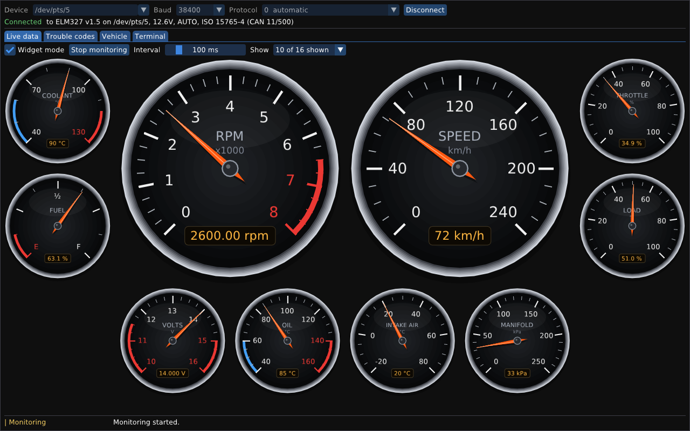
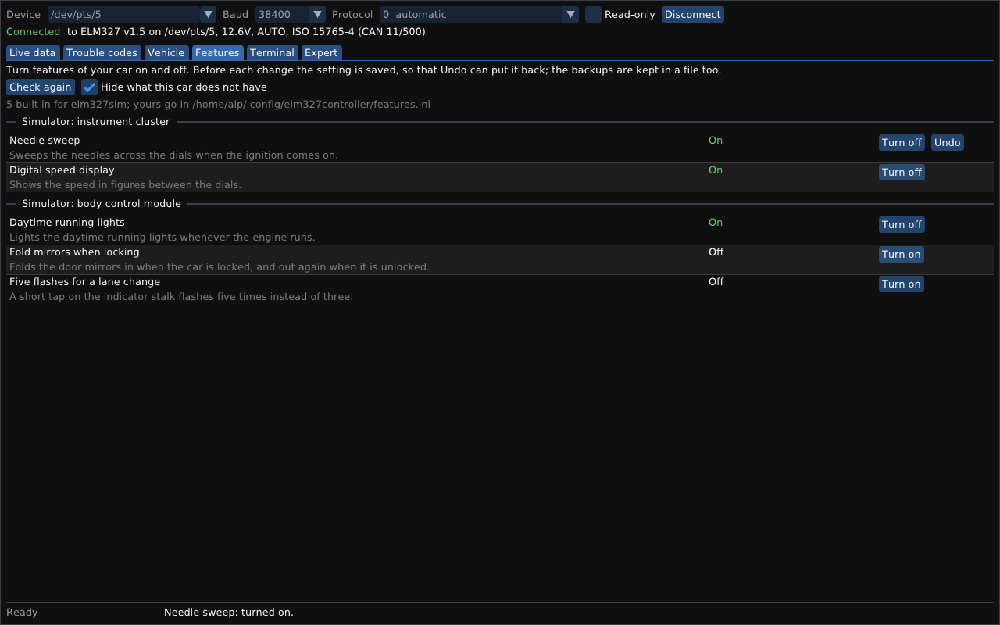
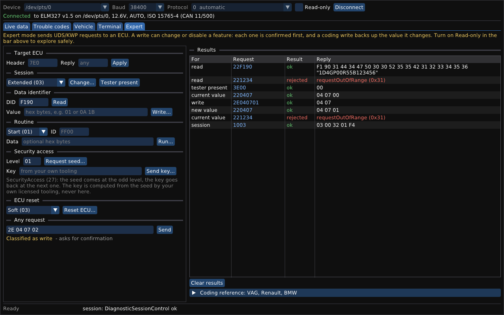

# Elm327Controller

Tools and a library for ELM327 OBD-II adapters on Linux, Windows and Android. They read live values, trouble
codes and the VIN from a vehicle, monitor values over time, and pass raw commands to the adapter. A
[read-only mode](#read-only-mode) makes the tools safe to leave connected to a car: it refuses, before
sending, anything that could change the vehicle. An [expert mode](#expert-mode-uds-kwp-and-coding)
adds UDS/KWP requests for the manufacturer-specific diagnostics and coding that tools such as VCDS,
OBDeleven, ddt4all and BimmerCode use. The GUI's [Features tab](#the-features-tab) turns features of
a car on and off with one button, from definitions that describe them, without showing any code.

The project has two parts:

- **`libelm327`**, a static library with everything needed to control an adapter: the serial
  protocol of the ELM327, the OBD-II services, and `Controller`, the connection the front-ends
  share.
- **The front-ends** built on it:
  - **`elm327ctl`**, a command-line tool. Started without a command it is an interactive shell that
    keeps the connection open between commands, with line editing, history and completion. Given a
    command, it runs that command once, for scripts.
  - **`elm327gui`**, a graphical front-end drawn with [Dear ImGui](https://github.com/ocornut/imgui):
    live data with plots, or in widget mode as the gauges of a classic car dashboard; trouble
    codes, the VIN, and a terminal for AT commands. On Android it is an app that connects to a
    paired Bluetooth adapter (see [Android](#android)).

`elm327sim` simulates an adapter and a vehicle on a pseudo-terminal (on Windows, a named pipe), to
try everything without hardware.

It is built on [Common](https://github.com/Emre-Balci/Common), the real-time foundation library.
Common and Dear ImGui are git submodules in `third_party/`. The library and the command-line tool
follow Common's rules: no heap, no exceptions, and every wait is bounded by a deadline.

Status: version 0.3.0. See [Next steps](#next-steps).


## Quick start

```bash
git clone --recurse-submodules https://github.com/Emre-Balci/Elm327Controller.git
cd Elm327Controller
sudo apt install libglfw3-dev     # for elm327gui; without it only the GUI is left out
cmake --preset gcc-release && cmake --build --preset gcc-release
```

On Windows, in a Developer PowerShell or Developer Command Prompt for Visual Studio 2022 (the GUI
needs GLFW, see [Building on Windows](#building-on-windows)):

```bat
git clone --recurse-submodules https://github.com/Emre-Balci/Elm327Controller.git
cd Elm327Controller
cmake --preset msvc-release && cmake --build --preset msvc-release
```

For the Android app, with the Android SDK and NDK (see [Building for Android](#building-for-android)):

```bash
cd android && ./gradlew assembleDebug   # app/build/outputs/apk/debug/app-debug.apk
```

If the repository was cloned without `--recurse-submodules`, run `git submodule update --init`.

No adapter at hand? `elm327sim` simulates one on a pseudo-terminal, connected to a car that keeps
accelerating and braking:

```bash
./build/gcc-release/sim/elm327sim &                  # prints e.g. "Simulated ELM327 on /dev/pts/5"
./build/gcc-release/cli/elm327ctl -d /dev/pts/5      # the interactive shell
./build/gcc-release/cli/elm327ctl -d /dev/pts/5 info # one command
./build/gcc-release/gui/elm327gui -d /dev/pts/5 --monitor 0C,0D
```

On Windows it offers a named pipe instead, which the tools open like a COM port:

```bat
start build\msvc-release\sim\elm327sim.exe
rem It prints e.g. "Simulated ELM327 on \\.\pipe\elm327sim-4242-0" in a window of its own.
build\msvc-release\cli\elm327ctl.exe -d \\.\pipe\elm327sim-4242-0
build\msvc-release\gui\elm327gui.exe -d \\.\pipe\elm327sim-4242-0 --monitor 0C,0D
```

`elm327sim --legacy` simulates an ISO 9141-2 car instead of a CAN car, `--ignition-off` a car that
does not answer, and `--slow` the reset and protocol-search times of a real adapter.

## The interactive shell

Without a command, `elm327ctl` reads commands line by line. The options of the command line become
its settings. The first command that needs the adapter connects to it, and the connection stays
open, so the adapter is reset once and the supported PIDs are read once:

```
$ elm327ctl -d /dev/pts/5
elm327ctl 0.3.0, the shell for ELM327 adapters. Type 'help' for the commands, 'quit' to leave.
elm327> info
Connected to ELM327 v1.5 on /dev/pts/5 at 38400 bit/s.
Adapter      ELM327 v1.5
Description  OBDII to RS232 Interpreter
Voltage      12.6V
Protocol     AUTO, ISO 15765-4 (CAN 11/500)
elm327> read 0C 0D
0C  Engine speed   900.00 rpm
0D  Vehicle speed  4 km/h
elm327> monitor -i 250 0C
# 0C  Engine speed [rpm]
  time [s]        0C
     0.000   2375.00
     0.250   2400.00
^Celm327ctl: 2 samples, 0 failed reads
elm327> set protocol 6
Disconnected: the next command connects with the new setting.
elm327> quit
```

| Command | What it does |
|---|---|
| `connect [DEVICE]` | connect to the adapter, at `DEVICE` if given (it becomes the device setting) |
| `disconnect` | close the connection |
| `info`, `pids`, `read PID...`, `monitor PID...`, `dtc`, `vin`, `raw COMMAND...` | as on the [command line](#commands-for-scripts) |
| `clear`, `uds SUBCOMMAND`, `coding [MAKE]` | as on the command line (see [read-only](#read-only-mode) and [expert mode](#expert-mode-uds-kwp-and-coding)) |
| `set NAME VALUE` | change a setting: `device`, `baud`, `protocol`, `timeout`, `interval`, `count`, `verbose`, `readonly` (`on`/`off`) |
| `show` (or `set` alone) | show the settings and the connection |
| `help` | list the commands, settings and keys |
| `quit`, `exit` | leave the shell (also Ctrl+D) |

The options of the command line work on a line for that command only, e.g. `monitor -i 250 -n 10
0C 0D` or `read -v 0C`. The connection settings are changed with `set` instead, and a change of
`device`, `baud`, `protocol` or `timeout` closes the connection, so that the next command connects
with it.

Keys: Ctrl+C stops the running command and returns to the prompt; at the prompt it discards the
line. Tab completes commands, settings and their values. Up and Down browse the history. The usual
editing keys of GNU Readline work: Home, End, Ctrl+A, Ctrl+E, Ctrl+U, Ctrl+K, Ctrl+W, Alt+B,
Alt+F, Ctrl+L. They work the same in a Windows console, where Ctrl+Break, or closing the window,
ends the shell after the port is closed.

Without a terminal, e.g. with `elm327ctl -d /dev/ttyUSB0 < script.txt`, the shell reads plain lines
without prompt or editing; `#` starts a comment. Its exit code is that of the last command.

## Commands for scripts

```
Usage: elm327ctl [options] [command [arguments]]

Commands:
  info              adapter identity, supply voltage and the vehicle's protocol
  pids              list the service 01 PIDs the vehicle supports
  read PID...       read service 01 PIDs once, e.g. 'read 0C 0D 05'
  monitor PID...    read PIDs repeatedly until Ctrl+C (see -i, -n)
  dtc               read the MIL status and the stored, pending and permanent DTCs
  vin               read the vehicle identification number
  clear             clear the DTCs and turn the MIL off (service 04; needs -y)
  raw COMMAND...    send AT commands or OBD requests and print the replies
  uds SUBCOMMAND    expert mode: UDS/KWP requests to an ECU (try 'uds help')
  coding [MAKE]     reference list of common owner codings (vag, renault, bmw)
  help              show this help

Options:
  -d, --device PATH   serial device (default /dev/ttyUSB0)
  -b, --baud RATE     bit rate (default 38400)
  -p, --protocol N    OBD protocol 0-9 or A-C (default 0: automatic)
  -t, --timeout MS    reply timeout of a command in ms (default 5000)
  -i, --interval MS   monitor: time between samples in ms (default 1000)
  -n, --count N       monitor: stop after N samples (default 0: until Ctrl+C)
  -r, --read-only     safe mode: refuse any command that could change the vehicle
  -y, --yes           confirm a write (clear, uds write) without prompting
  -v, --verbose       print the traffic with the adapter on stderr
  -h, --help          show this help
      --version       show the version
```

Examples, from the simulator:

```
$ elm327ctl read 0C 0D 05 42 A6 0A
0C  Engine speed                900.00 rpm
0D  Vehicle speed               4 km/h
05  Engine coolant temperature  20 degC
42  Control module voltage      14.000 V
A6  Odometer                    12345.6 km
0A  Fuel pressure               not supported by the vehicle

$ elm327ctl dtc
MIL          on, 2 confirmed DTCs
Stored       P0133 P0420
Pending      P0171
Permanent    P0420

$ elm327ctl -i 250 -n 3 monitor 0C 0D
# 0C  Engine speed [rpm]
# 0D  Vehicle speed [km/h]
  time [s]        0C        0D
     0.000   2375.00        63
     0.250   2400.00        64
     0.500   2475.00        67
elm327ctl: 3 samples, 0 failed reads

$ elm327ctl raw ATRV 0100
> ATRV
12.6V
> 0100
SEARCHING...
41 00 BE 3F 80 13
```

A command first resets the adapter and configures it (`ATZ`, `ATE0`, `ATL0`, and `ATSP` only if
the adapter has another protocol selected, because it stores the protocol in its EEPROM). `-v`
shows that traffic. Results go to stdout; errors, notices and the monitor summary go to stderr. The
`monitor` table is easy to parse: legend lines start with `#`, and samples keep the interval
without drifting.

Exit codes: 0 success, 1 the device, the adapter or the vehicle failed (or a PID could not be
read), 2 invalid command line, 128 + signal number when a signal stopped the program (130 for
Ctrl+C, 141 for a closed output pipe). On a signal the program finishes cleanly and closes the
serial port.

## Read-only mode

Read-only mode makes the tools safe to leave connected to a running car: the connection can read
everything but can change nothing. Turn it on with `-r`/`--read-only` on the command line, or `set
readonly on` (or start with `-r`) in the shell.

```bash
elm327ctl -d /dev/pts/5 -r raw ATRV 04     # ATRV is read and answered; 04 (clear DTCs) is refused
elm327ctl -d /dev/pts/5 -r uds write F190 ...   # refused: a UDS write
```

The guard lives in the library's `Controller`, below every front-end, so it covers the `clear`
command, every `raw` and `uds` request, and the GUI's terminal and Expert tab alike. It decides on
the service -- the first byte of an OBD/UDS request -- with a **default-deny** rule in
`elm327/obd/service.hpp`: a request is allowed only when its service is a known pure read (OBD-II 01,
02, 03, 05, 06, 07, 09, 0A; UDS/KWP ReadDataByIdentifier, ReadMemoryByAddress, ReadDTCInformation,
TesterPresent and the other read services). Everything else -- OBD-II 04 (clear) and 08 (actuator
test), every UDS write, session change, reset, routine, I/O control or security access, and anything
the library does not recognise -- is refused before a single byte is sent, with `kPermissionDenied`.
`AT` commands configure the adapter, not the car, so they are allowed. The classification ignores
spaces, so a write cannot be slipped past as "0 4". It is unit-tested, and controller, CLI and GUI
worker tests confirm that with read-only on, no write service ever reaches the simulated vehicle.

Read-only mode is the safe default to reach for on an unfamiliar car, or when only diagnosing.

## Expert mode (UDS, KWP and coding)

Beyond the standard OBD-II services, manufacturers reach their ECUs with UDS (ISO 14229) or the
older KWP2000 (ISO 14230): the same layer that VCDS and OBDeleven (VAG), ddt4all (Renault/Dacia) and
BimmerCode (BMW) build on to unlock and change features. `elm327ctl` speaks it with the `uds`
command, and `elm327gui` with its [Expert tab](#the-expert-tab). Set the target ECU's header first if
it is not the default (`raw ATSH7E0`, or *Target ECU* in the tab), then:

```
$ elm327ctl -d /dev/pts/5 uds read F190           # ReadDataByIdentifier (here, the VIN)
read: ReadDataByIdentifier ok
  data  F1 90 31 44 34 47 50 30 30 52 35 35 42 31 32 33 34 35 36
  text  "1D4GP00R55B123456"

$ elm327ctl -d /dev/pts/5 -y uds write 0407 01    # WriteDataByIdentifier (coding)
current value: ReadDataByIdentifier ok             # reads and shows the old value first
  data  04 07 00
write: WriteDataByIdentifier ok
new value: ReadDataByIdentifier ok                 # and reads it back to confirm
  data  04 07 01
```

`uds help` lists the subcommands: `read DID`, `write DID VALUE...`, `session HEX`, `reset
hard|soft|keyoffon`, `routine start|stop|poll ROUTINE [DATA...]`, `seed LEVEL`, `key LEVEL KEY...`,
`tester`, and `send HEX...` for an arbitrary request. Positive replies are named
(`ReadDataByIdentifier ok`), a printable value such as a VIN or a part number is shown as text too,
and negative replies are decoded to their reason (`securityAccessDenied (0x33)`). A `write` first
reads and prints the current value, and **writes only if it could read it** -- without that backup
there would be nothing to restore -- then reads the value again to confirm. `tester` asks the ECU for
an answer (`3E00`), so it also tells whether the ECU is there. The writes are refused in read-only
mode; `read`, `tester` and `send` of a read service are not.

Security access is framed only: `uds seed` requests a seed and `uds key` sends a key you supply.
The seed-to-key algorithm of a locked ECU is a manufacturer secret and is **not** included; compute
the key with tooling licensed for your own vehicle.

`coding [vag|renault|bmw]` prints a reference map of common owner codings -- the feature, the module
it usually lives in, and the UDS operation involved:

```
$ elm327ctl coding vag
Reference only: identifiers and values differ by model, year and firmware. ...

VAG      Needle sweep / gauge staging on start
  module  Instrument cluster (VCDS module 17)
  method  WriteDataByIdentifier (long-coding bit)
  note    Often a single coding bit; ... Read the cluster coding, flip the documented bit, ...
```

It ships no car-specific byte values on purpose: the identifiers and values differ by model, year
and firmware, and a wrong write can disable a feature or upset a module. Look the exact values up
against your own vehicle (the label files of VCDS/OBDeleven, ddt4all's ECU database, the coding data
behind BimmerCode, and your owner community), read the current value first, change one documented
field, and keep the original to restore.

### Responsible use

Coding changes your own vehicle at your own risk. Do it with the ignition on and a steady battery;
back up every value you change; and keep in mind that some changes (lighting, speed or seatbelt
warnings, emissions-related settings) are not road-legal in every market and may affect your
warranty, insurance or roadworthiness. This tool deliberately leaves out odometer, immobiliser and
emissions-defeat functions. You are responsible for what you write to a car and for complying with
the law where you drive.

## The GUI

`elm327gui` shows a connection bar (device, with a list of the USB and Bluetooth serial devices
found; baud rate; protocol; [Read-only](#read-only-mode)) and six tabs:

- **Live data**: the PIDs the vehicle supports, with their latest values. Ticked PIDs (up to 16)
  are monitored at the chosen interval and plotted, or, in widget mode, shown as gauges.
- **Trouble codes**: the MIL status and the stored, pending and permanent DTCs.
- **Vehicle**: the VIN, and what the adapter tells about itself.
- **Features**: features of the car with their state, each turned on and off with one button (see
  [the Features tab](#the-features-tab)).
- **Terminal**: the traffic with the adapter, and a line to send AT commands or OBD requests.
- **Expert**: UDS/KWP requests to an ECU, their results, and the coding reference (see
  [the Expert tab](#the-expert-tab)).

```
Usage: elm327gui [options]
  -d, --device PATH     serial device (default /dev/ttyUSB0)
  -b, --baud RATE       bit rate (default 38400)
  -p, --protocol N      OBD protocol 0-9 or A-C (default 0: automatic)
  -t, --timeout MS      reply timeout of a command in ms (default 5000)
  -c, --connect         connect at the start
  -m, --monitor PIDS    connect and monitor these PIDs, e.g. 0C,0D,05
  -i, --interval MS     time between the samples of the monitor (default 1000)
  -w, --widgets         widget mode: the live data as the gauges of a dashboard
  -r, --read-only       safe mode: refuse anything that could change the vehicle
      --tab NAME        open the tab live, codes, vehicle, features, terminal or expert
      --features FILE   the definitions of the Features tab (default: features.ini in
                        ~/.config/elm327controller)
      --screenshot FILE save the window as a PPM image once it is idle, then exit
```

### Widget mode

The **Widget mode** box of the Live data tab (or `--widgets`) turns the monitored PIDs into the
instruments of a classic car: round dials with a chrome bezel, white ticks and numerals, colored
zones and a needle that swings smoothly to the value, with the exact value in a small amber display.



- The PIDs whose value suits a dial have one: engine speed (with the red zone from 6500 rpm) and
  vehicle speed as the large dials; coolant, oil, intake and ambient temperature (blue when cold,
  red when hot); fuel level (E, 1/2, F, with the reserve in red); throttle, engine load,
  accelerator pedal; control-module voltage; manifold and barometric pressure, air flow, timing
  advance, fuel rate and pressure; and the fuel trims around 0.
- The other selected PIDs, such as the run time or the odometer, appear as digital displays below
  the dials.
- **Show** chooses what is on the dashboard; it is the same selection as the ticks of the table.
  Turned on, widget mode shows the default dashboard (tachometer, speedometer, coolant, fuel,
  throttle, load, voltage, oil, intake air, manifold pressure, as far as the vehicle supports
  them) unless the selection already holds a dial, and starts monitoring.
- The layout follows the window like an instrument cluster: the tachometer and the speedometer
  side by side, pairs of smaller dials beside them when there is room, the rest in even rows below.
  The dials shrink to fit and scroll only when they would get too small to read.

```bash
elm327gui -d /dev/pts/5 --connect --widgets        # the default dashboard
elm327gui -d /dev/pts/5 --widgets --monitor 0C,05,2F,A6 -i 250
```

The window never waits for the adapter: a worker thread owns the connection and runs the requests
of the window one after the other, and Cancel interrupts the one in progress. Closing the window,
or Ctrl+C in the terminal that started it, closes the serial port cleanly.

Building it needs GLFW 3.3 or later: `sudo apt install libglfw3-dev`, then configure again (on
Windows, see [Building on Windows](#building-on-windows)). Without GLFW, CMake leaves the GUI out
and says so; the library and `elm327ctl` build anyway.

On Linux it needs a display: X11 or Wayland, e.g. WSLg on Windows 11. `--screenshot` renders the
window, saves it and exits, for documentation and smoke tests.

### The Features tab

The **Features** tab (or `--tab features`) is the simple way to change a car: each feature shows
its state and has one button, and no code appears.



- When the tab opens, every feature is checked: **On**, **Off**, **Another value**, or **Not on
  this car**. Checking only reads, so it works in read-only mode too; *Check again* repeats it.
- **Turn on** / **Turn off** asks once, then changes the feature. **Undo** puts the setting back to
  what it was before your first change since you connected.
- Behind each button the engine refuses rather than guesses. It first checks that the module is the
  one the definition was made for (its part number, and the length of the setting). It reads the
  setting and keeps it as the backup, changes only the feature's bits, writes it in the diagnostic
  session the module needs, reads it back to verify, and returns the module to its normal session.
  If anything does not match, nothing is written.
- Every change is also recorded in `~/.config/elm327controller/backups.txt` (on Windows,
  `%APPDATA%\elm327controller\backups.txt`), e.g. `Needle sweep: module 714, DID 0600, before 12 00
  40 00, after 13 00 40 00`, so that it can be undone after the program has ended (in the Expert
  tab: target 714, then write DID 0600 with the *before* value).
- In read-only mode the buttons are disabled. *Hide what this car does not have* leaves out the
  features whose module is missing or another one.

The tab comes with the features of `elm327sim`'s simulated car, to try it without a car. They match
only the simulator: on a real car they find *Not on this car* and change nothing.

### Adding features for your car

A feature is defined once, in a text file, by someone who has verified it on the car; after that it
is one button. `elm327gui` reads `features.ini` from `~/.config/elm327controller/` (on Windows,
`%APPDATA%\elm327controller\`), or the file given with `--features`. This is the simulator's needle
sweep; for your car, every value comes from your car:

```ini
# One [section] per feature; lines that start with # or ; are comments.
[Needle sweep]
group    = Instrument cluster
about    = Sweeps the needles across the dials when the ignition comes on.
note     = Takes effect the next time the ignition comes on.
request  = 714
reply    = 77E
identify = F187 SIM-CLUSTER
did      = 0600
length   = 4
byte     = 0
bit      = 0
```

| Key | Meaning |
|---|---|
| `[name]` | The feature's name, as the tab shows it. |
| `group`, `about`, `note` | Optional: the heading it is listed under, what it does, and when it takes effect. |
| `request`, `reply` | The module's CAN identifiers: 3 hexadecimal digits (11 bit) or 8 (29 bit). |
| `identify` | A DID and the start of its value, usually the part number (DID `F187`); several separated by `\|`, or `*` for any module at that address. |
| `did`, `length` | The DID that holds the setting (e.g. a coding or an adaptation), and its length in bytes. |
| `byte`, `bit` | The byte with the feature (from 0), and its bit (0 is the rightmost), set when the feature is on. |
| `mask`, `on`, `off` | Instead of `bit`: the feature's bits in the byte, and their values when on and off, in hexadecimal. For a field such as a count of flashes, or a bit that is set when the feature is off. |
| `session` | Optional: the diagnostic session of the change, in hexadecimal (default `03`, the extended session). |
| `address` | Optional: the module's ISO-TP extended address, in hexadecimal (as on BMW). |

A definition without any of the required keys is rejected with its line, and so is the whole file,
so that a feature is never applied to a module it does not name. To find the values, read the
module's part number (DID `F187`) and the setting in the Expert tab first. Take the byte and bit
from a source that documents your exact module (the long-coding guides of VCDS and OBDeleven, the
ECU database of ddt4all, the BimmerCode community), and put your module's part number in `identify`.
Bits are counted from 0 on the right, as in the long-coding helper of VCDS.

What the tab cannot do yet:

- **Settings longer than 4 bytes.** A plain ELM327 sends one CAN frame per request, and a
  WriteDataByIdentifier of a two-byte DID carries at most 4 bytes in one. Many long codings are
  longer and need multi-frame sending; the tab says so instead of writing. Adaptation values and
  short codings fit.
- **Modules that need security access** for the change: the tab shows them as *Locked*.
- **Vehicles without CAN** (ISO 15765-4).

### The Expert tab

The **Expert** tab (or `--tab expert`) is [expert mode](#expert-mode-uds-kwp-and-coding) in the
window: what `uds` does on the command line, with the results in a table.



- **Target ECU**: the CAN identifier the requests go to (`ATSH`) and the one the replies come from
  (`ATCRA`, empty for any), e.g. 7E0 and 7E8 for the engine ECU. This only configures the adapter.
- **Session** (DiagnosticSessionControl) and **Tester present**; **Data identifier**: *Read* a DID
  (F190, the VIN, to start with) and *Write* a value with the same backup as `uds write` -- the
  current value is read first, the write goes only if that worked, and the value is read again;
  **Routine** (start, stop, results); **Security access** (a seed at an odd level, the key at the
  next one -- the key comes from your own tooling); **ECU reset**; and **Any request** in
  hexadecimal, which shows how the read-only gate classifies it as you type.
- **Results**: every request with its outcome -- *ok* with the bytes of the reply (and the text of a
  printable value such as the VIN), *rejected* with the decoded negative response code, *refused*
  in read-only mode, or *failed* with the adapter's reason.
- **Coding reference**: the map of `coding`, by make.

Each request that can change the vehicle first opens a confirmation that names it and what it
risks, and *Send* stays disabled until you tick that you have backed up what it changes. In
read-only mode those controls are disabled, and the requests would be refused anyway: the guard is
in the library, below the window.

## Android

The app is `elm327gui` with the same window and tabs, for phones and tablets with Android 9 or
later (64-bit). It runs in landscape, keeps clear of the status bar, the navigation bar and a
camera cutout, and keeps the screen on while it is connected. Text fields bring up the on-screen
keyboard.

- **Bluetooth adapters**: pair the adapter in Android's Bluetooth settings first (the PIN of most
  is 1234 or 0000). The list next to the device field shows the paired devices; the app starts
  with the first whose name contains OBD or ELM. On Android 12 and later it asks for the
  permission to connect to nearby devices. It does not scan, so it needs no location.
- **Simulator**: the same list offers the simulator, the car of `elm327sim` inside the app, so the
  app can be tried without a car. It calls itself "ELM327 v1.5 (simulator)" in the connection bar.
- **Your feature definitions** go into `features.ini` in `Android/data/io.github.emrebalci.elm327controller/files`
  on the phone's shared storage, which a computer reaches over USB. `backups.txt` is written there.

Bluetooth Low Energy, Wi-Fi and USB adapters are not supported yet (see [Next steps](#next-steps)).

## Connecting an adapter

- USB adapters (FTDI, CH340, PL2303 chips) appear as `/dev/ttyUSB0`. Bluetooth adapters appear as
  `/dev/rfcomm0` once bound with `rfcomm`.
- Opening the device needs the `dialout` group: `sudo usermod -aG dialout "$USER"`, then log in
  again.
- On Windows an adapter is a COM port, which the Device Manager lists under *Ports (COM & LPT)*,
  e.g. `COM3` (the default) or `COM12`. A paired Bluetooth adapter has two; the outgoing one
  talks to it. The device list of the GUI shows the COM ports there are. A port that another
  program has open is reported as in use.
- Most adapters talk at 38400 bit/s, the default. If the adapter does not answer, try 9600 or
  115200 (`-b`, `set baud`, or the Baud list of the GUI).
- On Android, pair a Bluetooth adapter in the settings and choose it in the app; see
  [Android](#android).
- WSL does not see USB devices by default. Attach the adapter with
  [usbipd-win](https://github.com/dorssel/usbipd-win): in an administrator PowerShell, `usbipd list`,
  then `usbipd bind --busid <id>` once and `usbipd attach --wsl --busid <id>`.
- The vehicle's ignition must be on. The first request after a reset can take several seconds,
  while the adapter searches for the vehicle's protocol (`SEARCHING...`); protocol 6 (CAN 11 bit,
  500 kbit/s, most cars since 2008) skips the search.

## The library

`libelm327` is the static library `lib/`, with its headers in `lib/include/elm327/<group>/`:

| Layer | Where | What it does |
|---|---|---|
| Adapter | `elm327/adapter/` | `Adapter` sends a command over the serial port (or a connected stream socket, `open_stream()`) and collects the reply lines up to the `>` prompt, within a deadline and cancellable through a descriptor. After a command was interrupted, the next one waits for its late reply or stops the adapter, so a program can go on after Ctrl+C. `Response` classifies the lines (`OK`, `NO DATA`, `UNABLE TO CONNECT`, `CAN ERROR`, ...). |
| OBD-II | `elm327/obd/` | `parse_messages()` turns reply lines into vehicle messages, including CAN multi-frame replies. `pid.hpp` names and decodes the service 01 PIDs exactly, `dtc.hpp` and `vin.hpp` decode trouble codes and the VIN in the CAN and the older formats. `ObdClient` runs the requests (and `clear_dtcs()`, service 04). `service.hpp` classifies a request as read or write for the read-only gate. |
| Expert | `elm327/expert/` | `uds.hpp` builds and decodes UDS (ISO 14229) and KWP2000 requests -- session control, read/write data by identifier, routine control, security access, ECU reset, tester present -- and names the negative response codes. `decode_uds_response()` turns the adapter's reply, multi-frame included, into a `UdsExchange` that owns its bytes; both front-ends use it. `feature.hpp` reads [feature definitions](#adding-features-for-your-car) and `FeatureCoder` turns a feature on and off safely: identification and length checks, backup, session, write, verification, restore. `coding.hpp` is a reference map of common owner codings for VAG, Renault and BMW (no car-specific values). |
| Controller | `elm327/controller/` | `Controller` keeps a connection: it opens and initializes the adapter in one step and tells which step failed (a front-end's `LinkOpener` opens devices that are not serial devices, e.g. the Android app's Bluetooth links), reads the supported PIDs once, notices an unplugged device, and returns PID values that own their bytes. Its access policy enforces [read-only mode](#read-only-mode) on every write. `explain.hpp` puts failures into words, `signals.hpp` stops a program cleanly on Ctrl+C, and `timing.hpp` schedules periodic reads without drift. |

A program uses it like this:

```cpp
#include "elm327/controller/controller.hpp"
#include "elm327/controller/explain.hpp"

elm327::Controller controller{};
elm327::ConnectionSettings settings{};  // /dev/ttyUSB0 or COM3, 38400 bit/s, automatic protocol
static_cast<void>(settings.device.assign("/dev/rfcomm0"));
const common::Status status{controller.connect(settings)};
if (common::is_ok(status)) {
    const elm327::PidReading speed{controller.read_pid(0x0DU)};
    // speed.status, speed.value (an exact Measurement), format_reading(): "42 km/h"
} else {
    const elm327::Explanation why{elm327::explain_connect_failure(controller.connect_failure(), status)};
    // why.reason: e.g. "no such device"; why.advice: what to do about it
}
```

A CMake project adds the repository with `add_subdirectory()` and links `elm327::elm327`. As a
subproject it builds only the library unless `ELM327_BUILD_CLI`, `ELM327_BUILD_GUI`,
`ELM327_BUILD_SIMULATOR` or `ELM327_BUILD_TESTS` ask for more.

What Common provides:

| Need | Common component |
|---|---|
| Serial line in raw mode, exclusive access, deadlines, unplug detection | `file/serial_port.hpp` (`SerialPort`) |
| Splitting the byte stream into lines and the `>` prompt | `protocol/delimited_framer.hpp` (`DelimitedFramer`, `ByteSet`) |
| Matching messages, checked hex parsing, formatting | `protocol/text.hpp` |
| Big-endian fields and "supported PIDs" bitmaps | `protocol/byte_order.hpp` |
| One deadline per command, monotonic time | `time/deadline.hpp`, `time/clock.hpp` |
| Exact decoded values, rounded once | `numeric/decimal.hpp`, `numeric/integer.hpp` |
| Fixed-capacity storage | `containers/static_string.hpp`, `static_vector.hpp`, `span.hpp` |
| The GUI's worker thread, and the queues between it and the window | `system/thread.hpp` (`RtThread`), `concurrency/spsc_queue.hpp`, `concurrency/triple_buffer.hpp` |
| Errors without exceptions | `core/status.hpp` (`Status`, `Result<T>`) |
| Compiler policy: warnings, `-Werror`, `-fno-exceptions`, sanitizers | `common::options` |

Decoded values are exact: `decode_pid()` evaluates the formula of a PID with integers and rounds
the result once, half to even, to the resolution of the PID, so `(256 * A + B) / 4` prints as
`1726.25 rpm` and never as `1726.2499999`.

## How the front-ends work

| Part | Where | What it does |
|---|---|---|
| Commands | `cli/commands.hpp` | `Session` runs the commands over a `Controller`: once for the command line, one after the other for the shell. Output goes through `Console`, without stdio. |
| Shell | `cli/shell.hpp`, `cli/terminal.hpp`, `cli/line_editor.hpp` | The shell reads lines through `LineInput`: in raw mode on a terminal, where `LineEditor` turns the keys into a line, or as plain lines from a pipe. While a command runs the terminal is back in its normal mode, so Ctrl+C reaches the command as SIGINT (through `StopSignals`; on Windows as a console control event), and the shell takes the request and goes on. |
| GUI worker | `gui/worker.hpp` | `Worker` owns the `Controller` on its own thread. The window posts requests through an `SpscQueue`; the worker publishes a `State` snapshot through a `TripleBuffer`, and PID samples, the traffic, the results of expert mode (`UdsResult`) and of the Features tab (`FeatureResult`) through four more queues. Nobody waits for anybody; `cancel()` interrupts the operation in progress. |
| GUI window | `gui/app.hpp`, `gui/main.cpp` | `App` draws the State with ImGui each frame and turns clicks into requests. `main.cpp` sets up GLFW and the OpenGL 3 backend, and redraws on input, on a result of the worker, or 30 times per second while it works. |
| Android app | `android/`, `gui/main_android.cpp`, `gui/android_bridge.hpp` | `MainActivity` (Java) is a `NativeActivity`, and `main_android.cpp` draws the same `App` on OpenGL ES 3 in its window. `android_bridge.hpp` reaches what only Java can: the paired Bluetooth devices, the links to them, the on-screen keyboard and the insets of the window. A link is a socket pair: `MainActivity` connects a `BluetoothSocket` and copies the bytes between it and one end, and the `Adapter` reads and writes the other end. |
| Widget mode | `gui/gauge.hpp`, `gui/dashboard.hpp` | `gauge.hpp` knows which PIDs suit a dial and the scale of each (range, ticks, zones, words such as E and F), the geometry of needle and ticks, and plans the layout of a dashboard; it does not draw, so the tests cover it. `Dashboard` draws the dials and the digital displays with ImGui's draw lists, and moves each needle smoothly toward its value. |
| Simulator | `sim/` | `FakeElm327`, a simulated adapter and vehicle on a pseudo-terminal (on Windows, a named pipe; or a socket pair): the fixture of the tests and the core of `elm327sim`. `demo.hpp` drives its car, for `elm327sim` and as the demo device of the Android app. |

## Building and testing

On Linux (or WSL) it requires CMake 3.21 or later, Ninja, and GCC 9+ or Clang 10+. The GUI also
needs GLFW 3.3 or later (`sudo apt install libglfw3-dev`); OpenGL is loaded at run time, so no
OpenGL development files are needed.

```bash
cmake --preset gcc-debug          # also: gcc-release, clang-debug, clang-release, asan, tsan, tidy
cmake --build --preset gcc-debug
ctest --preset gcc-debug
```

| Option | Default | What it does |
|---|---|---|
| `ELM327_BUILD_CLI` | `ON` when top level | build `elm327ctl` |
| `ELM327_BUILD_GUI` | `AUTO` when top level, else `OFF` | build `elm327gui`: `AUTO` when GLFW and the imgui submodule are there, `ON` requires them |
| `ELM327_BUILD_SIMULATOR` | `ON` when top level | build `elm327sim` |
| `ELM327_BUILD_TESTS` | `ON` when top level | build the tests |
| `ELM327_WARNINGS_AS_ERRORS` | `ON` when top level | `-Werror` |
| `ELM327_ENABLE_CLANG_TIDY` | `OFF` | run clang-tidy on this project's sources (the `tidy` preset) |

The tests (`build/<preset>/tests/elm327_tests [name-filter]`) cover the parsing and decoding, run
the adapter, the controller and every command of the command line and the shell against the
simulated adapter, drive the shell on a pseudo-terminal (on Windows, a pseudo console) like a person
at a keyboard, run the GUI's worker thread, and check the scales and the layout of the gauges of
widget mode. Run the `asan` and `tsan` presets after changing anything that waits, reads or uses
threads. The `tidy` preset needs `sudo apt install clang-tidy`.

### Building on Windows

Requires Windows 10 (1903 or later) or Windows 11 on x64, and Visual Studio 2022 (MSVC 19.30 or
later) with the "Desktop development with C++" workload, which includes CMake and Ninja. In a
Developer PowerShell or Developer Command Prompt for VS 2022:

```bat
cmake --preset msvc-debug          &rem also: msvc-release, msvc-asan
cmake --build --preset msvc-debug
ctest --preset msvc-debug
```

Visual Studio and VS Code (CMake Tools) open the folder and offer the same presets; each host only
lists its own. The build uses Common's MSVC settings: `/W4` with warnings close to the GCC/Clang
set, `/WX`, and no exceptions or RTTI. Run `msvc-release` too before finishing a change: MSVC's
optimizer has produced wrong code that the debug build did not show (see Common's README).

Windows has no GLFW, so the GUI is left out until CMake finds one: install it with
[vcpkg](https://vcpkg.io) (`vcpkg install glfw3`, and configure with
`-DCMAKE_TOOLCHAIN_FILE=<vcpkg root>/scripts/buildsystems/vcpkg.cmake`), or build GLFW 3.3 or later
from source, install it and configure with `-DCMAKE_PREFIX_PATH=<its install directory>`. A GLFW
DLL is copied next to `elm327gui.exe`.

### Windows

Everything builds and runs on Windows, and the tests pass there. What differs:

| | Linux | Windows |
|---|---|---|
| Serial device | `/dev/ttyUSB0` (the default), `/dev/rfcomm0` | a COM port: `COM3` (the default), `COM12` |
| `elm327sim` | a pseudo-terminal, e.g. `/dev/pts/5` | a named pipe, e.g. `\\.\pipe\elm327sim-4242-0`, which the library opens in place of a COM port |
| Stop requests | SIGINT (Ctrl+C), SIGTERM, SIGHUP, SIGPIPE, through a signalfd | the console's control events: Ctrl+C (reported as SIGINT), Ctrl+Break (SIGBREAK) and closing the window (SIGTERM; Windows ends the program a few seconds later) |
| Cancel descriptors | an eventfd or the signalfd | a manual-reset event (`common::NativeHandle`) |
| Shell | the terminal in raw mode | the console in raw mode, with the escape sequences of a terminal for the keys and the drawing (Windows 10 and later) |
| GUI's configuration | `~/.config/elm327controller` | `%APPDATA%\elm327controller` |
| Permissions | the `dialout` group | none; a port that another program has open is in use |

The programs take UTF-8 arguments, e.g. file paths, through a manifest that makes UTF-8 their code
page. The serial port is Common's `SerialPort`, with overlapped I/O that ends at the deadline; the
adapter's reads end at the cancel event too.

### Building for Android

Requires the Android SDK with the NDK r29 (Android Studio installs both), and JDK 17 or later. The
app is a Gradle project in `android/`, whose native code is this CMake project: open `android/` in
Android Studio, or build it on the command line with `ANDROID_HOME` set to the SDK:

```bash
cd android
./gradlew assembleDebug     # app/build/outputs/apk/debug/app-debug.apk, for arm64-v8a and x86_64
./gradlew installDebug      # onto the phone connected with adb
```

A release build (`assembleRelease`) needs a signing key of your own (see Android's documentation).

The library, the command-line tool and the tests also build with the NDK alone. With
`ANDROID_NDK_HOME` set to it:

```bash
cmake --preset android-arm64 && cmake --build --preset android-arm64
cmake --preset android-x86_64 && cmake --build --preset android-x86_64
ctest --preset android-x86_64
```

`android-x86_64` links the executables statically, so the tests run on the Linux host itself with
Android's C library (bionic), without an emulator. `adb push` them to run them on a device.

### What differs on Android

What differs from Linux:

| | Linux | Android |
|---|---|---|
| Platforms | | Android 9 (API level 28) or later, 64-bit: arm64-v8a and x86_64 (Common's requirements) |
| GUI | GLFW and OpenGL 3, a window | a `NativeActivity` with OpenGL ES 3, landscape, in a Gradle project (`android/`) |
| Adapter | a serial device | a paired Bluetooth adapter (`bt:<address>`), linked through `MainActivity` and opened with `Adapter::open_stream()`; or the simulator in the app (`sim`) |
| Failures | advice about devices and the `dialout` group | advice about pairing, the permission for nearby devices, and Bluetooth being off |
| GUI's configuration | `~/.config/elm327controller` | the app's directory on the shared storage, `Android/data/<app>/files` |
| `elm327ctl` | | builds and runs, e.g. under `adb shell`; a USB adapter's `/dev/ttyUSB0` needs a rooted phone |

## Rules

The library (`lib/`) and the command-line tool (`cli/`) follow the rules of Common's README: no
heap, no blocking without a deadline, no exceptions, bounded loops, monotonic time, no
floating-point equality, and the MISRA C++:2023 style (fixed-width types, brace initialisation,
explicit casts, `final` classes, `[[nodiscard]]`). They add no MISRA deviations of their own; the
deviations of Common are listed in its README. Two waits have no deadline by nature: the shell
waits for the user to type, and the GUI's worker for the next request; both can always be ended
through a descriptor.

The GUI's own code (`gui/`) follows the same rules, and its worker is part of the tests, but Dear
ImGui and GLFW allocate on the heap and are compiled without this project's checks; the plots
convert the exact values to `float` for drawing only. On Android it reaches Java through JNI, and
the app's Java code (`android/`) and its demo device, the simulator, are outside the compliance
scope. The simulator and the tests use
`std::string`, `std::thread` and `<cstdio>` and are outside the compliance scope, like Common's
tests and examples.

## Updating the submodules

`third_party/common` is pinned to a commit of Common, `third_party/imgui` to a release of Dear
ImGui (v1.92.9b). To move Common to the latest `main`:

```bash
git -C third_party/common pull origin main
git add third_party/common
git commit -m "Update Common"
```

and Dear ImGui to another release, e.g.:

```bash
git -C third_party/imgui fetch --tags && git -C third_party/imgui checkout v1.93.0
git add third_party/imgui
git commit -m "Update Dear ImGui to 1.93.0"
```

## Next steps

- Multi-frame (ISO-TP) sending through a plain ELM327, so that the Features tab can write long
  codings; it needs testing on real adapters, whose clones differ.
- Feature definitions for specific cars, each verified on the car it names.
- Freeze-frame data (service 02) and the readiness monitors of PID 01.
- Headers on (`ATH1`), to tell which ECU answered.
- Faster monitoring: several PIDs per request on CAN, and the expected reply count after a request.
- Baud-rate detection, and adapters over TCP (Wi-Fi).
- Trying the Windows build with real USB and Bluetooth adapters: the tests reach its I/O through
  the simulator's named pipe, not through a COM port.
- Trying the Android app with real Bluetooth adapters: the tests reach the stream I/O through the
  simulator's socket pair, and the Java side was built and linted but not run on a phone here.
- Adapters with Bluetooth Low Energy, Wi-Fi or USB (OTG) in the Android app, and remembering the
  last adapter.
- CSV output for `monitor`, and recording from the GUI.
- A persistent history for the shell.
